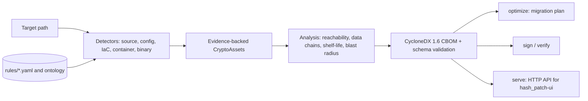

# Hash Patch

**Offline cryptographic discovery and post-quantum risk analysis.** Hash Patch scans source code, configs, IaC, containers and binaries, emits a CycloneDX 1.6 Cryptography Bill of Materials (CBOM), and tells you which cryptography is reachable, how long your data must stay secret, and what to migrate first.

[](https://github.com/shriram-s7/hash_patch/releases/latest)

**Links:** [GitHub](https://github.com/shriram-s7/hash_patch) · [Release v0.1.0](https://github.com/shriram-s7/hash_patch/releases/tag/v0.1.0) · [Demo video](https://youtu.be/5Hb2-dnYOR8) · UI repository: [hash_patch-ui](https://github.com/shriram-s7/hash_patch-ui)

## Overview

Quantum computers running Shor's algorithm would break RSA and elliptic-curve cryptography, and data stolen today can be decrypted later ("harvest now, decrypt later"). Organisations first need an inventory of where cryptography is used. Hash Patch builds that inventory entirely offline and ties every finding to direct evidence (file, line, column, byte offset, snippet). It was built for Smart India Hackathon 2026, problem statement 26164 (NTRO).

The name (*pratyaksha*, "direct perception") is the design rule: a finding without evidence is never emitted, and anything inferred by the optional local LLM is labelled `inferred` and kept out of the confirmed inventory (see `CLAUDE.md`).

## Features

- **Detection:** Java, Python, Go and C source (Tree-sitter), plus certificates, config files (legacy TLS settings), Infrastructure-as-Code, cloud KMS usage, container manifests and binaries (`hash_patch/detect/`, YAML rules in `rules/`).
- **Reachability and data chains:** call-graph analysis separates crypto reachable from entry points from dead or test-only crypto, and traces key-derivation to cipher flows (`hash_patch/analyze/`).
- **Shelf-life (Mosca-style) analysis:** compares how long data must stay confidential, how long migration takes, and quantum-arrival scenarios (`ontology/quantum_arrival.yaml`, `docs/`).
- **Blast radius and contradictions:** estimates the size impact of PQC replacements and flags contradictory algorithm evidence.
- **Migration optimiser:** greedy scheduler under an engineer-day budget and parallelism limit, compared with a brute-force baseline (`docs/OPTIMISER.md`).
- **Signing:** `keygen`, `sign` and `verify` commands for CBOMs.
- **Benchmarking:** `benchmark` command; results can be cited in a scan via `--benchmark-report`.
- **Local service and Q&A:** `serve` starts a FastAPI service for the UI, with grounded question answering that can use a local Ollama model.

## How it works



Output is deterministic: scanning the same input twice yields a byte-identical CBOM apart from the scan timestamp. The vendored CycloneDX schemas in `schemas/` are used for offline validation.

## 📥 Desktop Downloads (Windows x64)

The desktop application packages the full offline backend engine, the modern forensic terminal UI, and optional local AI capabilities into an air-gapped bundle:

| Version | Package | Format | Direct Download Link |
| :--- | :--- | :--- | :--- |
| **v0.1.0** | **Windows Installer (Recommended)** | NSIS `.exe` | [**Download HashPatch-Setup.exe**](https://github.com/shriram-s7/hash_patch/releases/download/v0.1.0/HashPatch-Setup.exe) |
| **v0.1.0** | **Windows Standalone Portable** | Single `.exe` | [**Download HashPatch-Portable.exe**](https://github.com/shriram-s7/hash_patch/releases/download/v0.1.0/HashPatch-Portable.exe) |

> 🔗 Full Release Notes & Checksums: [**GitHub Releases**](https://github.com/shriram-s7/hash_patch/releases/latest)

---

## 💻 System Requirements & Compatibility

- **Core Discovery & Engine (Pillars 1 to 5)**:
  - **Memory:** 2 GB – 4 GB RAM minimum
  - **CPU:** Any modern x86_64 / ARM64 processor
  - **Network:** **Zero network connection required.** 100% air-gap compatible.
  - All AST multi-language scanning (C, Go, Java, Python), CycloneDX 1.6 CBOM generation, static call-graph reachability, and risk estimation run deterministically with minimal resource footprints.
- **Offline AI Assistant ("Ask" / Natural Language Q&A)**:
  - Powered locally by Ollama running `llama3.2:3b`.
  - **Memory:** 6 GB to 8 GB+ RAM recommended to comfortably host the local model.
  - *Note:* On low-RAM or headless systems, the core engine still provides comprehensive rule-based grounded answers without needing the local LLM.

---

## Tech stack

| Layer | Technology |
|---|---|
| Language | Python 3.11+ |
| Parsing | Tree-sitter (Java, Python, Go, C), python-hcl2 |
| Data model | Pydantic v2, CycloneDX (`cyclonedx-python-lib`), `jsonschema` |
| CLI | Typer, Rich |
| Service | FastAPI, Uvicorn (optional extra) |
| Local AI (optional) | Ollama (`llama3.2:3b` in the desktop bundle) |
| Dev tooling | pytest, ruff, mypy, uv lockfile |

## Project structure

```text
hash_patch/        Python package
  detect/          language, config, IaC, container, binary and KMS detectors
  analyze/         reachability, data chains, shelf-life, blast radius, optimizer
  emit/            CycloneDX serialiser and schema validation
  sign/            key generation, CBOM signing and verification
  qa/              grounded question answering over a scan (optional Ollama)
  recommend/       PQC migration recommendations
  benchmark/       benchmark runner
  service.py       FastAPI service used by the UI
rules/  ontology/  schemas/   YAML rules, PQC/quantum data, vendored schemas
docs/              design notes (blast radius, contradictions, optimiser, benchmarking, coverage)
tests/  testdata/  test1/     unit, golden and fixture projects
```

## Getting started

Prerequisites: Python 3.11 or newer and `git`.

```powershell
git clone https://github.com/shriram-s7/hash_patch.git
cd hash_patch
python -m venv .venv
.\.venv\Scripts\Activate.ps1
pip install -e ".[dev]"
hash-patch version
```

```bash
git clone https://github.com/shriram-s7/hash_patch.git
cd hash_patch
python -m venv .venv && source .venv/bin/activate
pip install -e ".[dev]"
hash-patch version
```

No environment variables are required.

## Usage

```bash
# Scan a project and write a validated CycloneDX 1.6 CBOM
hash-patch scan path/to/project --output cbom.json --verbose

# Build a migration plan from that CBOM (budget in engineer-days)
hash-patch optimize cbom.json --budget-days 30 --parallelism 3 --output plan.json

# Sign and verify
hash-patch keygen --help
hash-patch sign --help
hash-patch verify --help

# Start the local service for the UI (the UI defaults to port 8000)
hash-patch serve --port 8000
```

Commands available: `version`, `scan`, `optimize`, `keygen`, `sign`, `verify`, `benchmark`, `serve`. Fixture projects for trying a scan are in `testdata/` and `test1/`.

To use the web UI, run `hash-patch serve --port 8000` and then start [hash_patch-ui](https://github.com/shriram-s7/hash_patch-ui). The desktop installer bundles both.

## Tests

```bash
pytest
ruff check .
```

Observed when this README was written (Windows, Python 3.x): **808 passed, 17 skipped** in about 4 minutes. The `ruff` run was not repeated while writing this README.

## Status and limitations

- Version 0.1.0; the CLI, detectors, CBOM emission, optimiser, signing and service are implemented and tested.
- Detection covers the languages and file types listed above; other languages are not parsed.
- Quantum-arrival scenarios are modelling assumptions, not predictions (see `docs/OPTIMISER.md`).
- The local LLM is optional and only supplements rule-based, evidence-grounded answers.
- Desktop packaging (Electron) lives outside this repository; the installers are attached to the release.

## Credits

Built by S Shriram for Smart India Hackathon 2026 (problem statement 26164, NTRO).

## License

No license specified.
